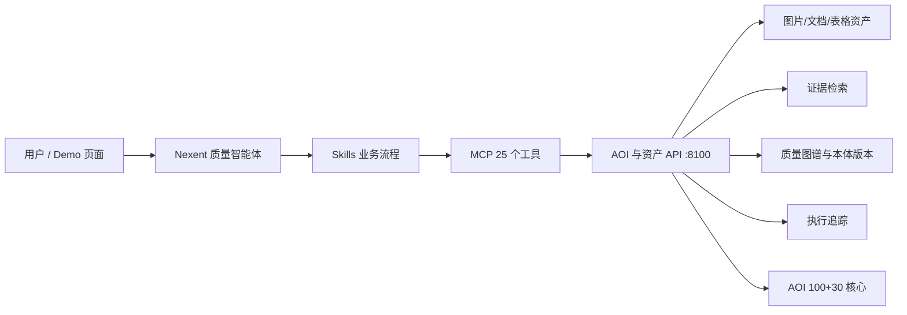

# Nexent v2.6.0 接入记录

本机 Nexent 地址为 `http://localhost:3000`。AOI 业务页面为 `http://localhost:8100`，MCP 端点为 `http://host.docker.internal:8101/mcp`。

## 已安装资源

- MCP：`AOI Quality Assets`，25 个工具，连接状态正常。
- Skills：`asset-recognition`、`quality-analysis`、`ontology-update`。
- 主智能体：`智适检·可进化质量资产智能体`（内部名 `aoi_quality_agent`）。
- 智能体已启用全部 25 个 AOI MCP 工具和 3 个 Skill。

## 执行架构

`analyze_quality_assets` 把统一解析、证据检索、图谱推理和执行追踪串成一个工具调用。模型训练与本体更新分别治理：AOI 候选通过固定验证集后才发布；本体候选经人工审核后才发布。

## 当前运行前置条件

当前租户尚未配置 LLM，智能体草稿、MCP 与 Skills 已就绪，但 Nexent 对话需要先在“模型配置”中添加一个可用聊天模型，再把该模型分配给 `aoi_quality_agent`。API Key 不写入本仓库。

模型配置完成后的平台验收问题：

1. “读取这两个资产 ID，分析 LOT-2026-A 的异常、标准依据和处理措施，并给出证据位置。”
2. “对这些图片执行人工复核测试，返回模型版本、异常分数和阈值。”
3. “根据新增规范提出本体变更；先展示候选，不要直接发布。”

固定业务验收报告位于 `data/demo_knowledge_acceptance.json`。业务单元与行为回归测试使用 `python -m unittest discover -s tests -v`。
