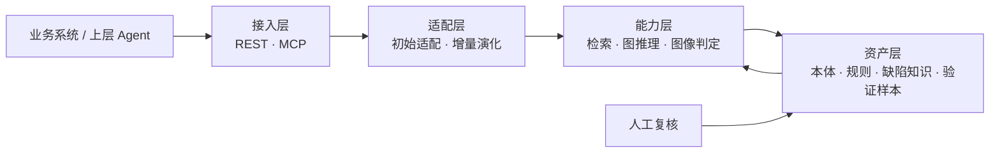

# AOI 质量资产智能体
面向工业 AOI（自动光学检测）场景的**可演化质量资产智能体**：把检测标准、缺陷知识、判定规则与人工复核反馈组织成可以持续积累的资产，让检测能力随产线反馈不断演进，而不是停在一次性的模型交付上。
> **使用限制**
> 本项目仅限学习、研究与个人非商业用途。未经作者书面许可，禁止任何形式的商业使用、二次分发，以及将本项目（含修改版本）用于任何竞赛、评奖或对外商业交付。
> 完整条款见 [LICENSE](LICENSE)；第三方组件遵循其原始许可，见 [THIRD_PARTY_NOTICES.md](THIRD_PARTY_NOTICES.md)。
## 目录
- [解决什么问题](#解决什么问题)
- [核心能力](#核心能力)
- [架构概览](#架构概览)
- [快速开始](#快速开始)
- [对外接口](#对外接口)
- [配置说明](#配置说明)
- [目录结构](#目录结构)
- [文档](#文档)
- [参与与反馈](#参与与反馈)
- [第三方组件](#第三方组件)
- [License](#license)
- [English Summary](#english-summary)
## 解决什么问题
AOI 项目常见的三个断点：
- **能力无法沉淀**：每次换料号、换产线都要重新调参、重新标注，上一轮的经验留在工程师的电脑里。
- **判定依据分散**：检测标准、工艺文件、缺陷图谱、历史复判结论散落在文档和图片中，难以被系统检索和复用。
- **反馈闭环缺失**：人工复判产生的样本没有回流到规则和阈值，误判与漏判长期反复出现。
本项目把上述内容抽象为**质量资产**（本体、缺陷知识、判定规则、验证样本），并提供一个能读写这些资产、接受人工反馈并持续演化的智能体。
## 核心能力
- **双模式适配**：支持初始适配（新场景冷启动）与增量演化（已有场景扩展）两种工作模式。
- **资产版本化**：本体、规则、词典以版本形式管理，每次演化可追溯、可回滚。
- **跨文档检索与图推理**：在检测标准、工艺文档与历史案例之间建立关联，为判定提供依据链。
- **人工复核闭环**：样本级反馈进入累计池，驱动规则与阈值迭代，并保留复核记录。
- **工具化对外**：以 MCP（Model Context Protocol）方式暴露能力，可被上层 Agent 或业务系统编排调用。
- **可复现验收**：固定冻结验证集，评估流程可重复执行，指标与结论一一对应。
## 架构概览

分层职责：
| 层 | 职责 |
| --- | --- |
| 接入层 | 对外提供 REST 接口与 MCP 工具，负责协议转换与鉴权 |
| 适配层 | 处理新场景接入与既有场景的资产扩展 |
| 能力层 | 文档检索、图推理、图像推理与异常判定 |
| 资产层 | 质量资产的存储、版本管理与检索 |
## 快速开始
环境要求：
- Python 3.10+
- 可选：Docker（容器化运行）、任意 MCP 客户端
```bash
git clone https://github.com/XuKeyY/AOI-Evolvable-Quality-Asset-Agent.git
cd AOI-Evolvable-Quality-Asset-Agent
python -m venv .venv
source .venv/bin/activate        # Windows: .venv\Scripts\activate
pip install -r requirements.txt
cp .env.example .env             # 按实际情况填写配置
```
启动业务服务：
```bash
uvicorn app.main:app --host 127.0.0.1 --port 8100
```
打开 `http://127.0.0.1:8100/docs` 查看交互式 API 文档。
> 首次运行前请先准备质量资产目录（本体、规则、词典），并在 `.env` 中指向该目录。
## 对外接口
**REST**
| 方法 | 路径 | 说明 |
| --- | --- | --- |
| `GET` | `/health` | 健康检查 |
| `POST` | `/inspect` | 提交待检图像，返回判定结果与依据 |
| `POST` | `/feedback` | 提交人工复核结论，进入累计池 |
| `GET` | `/assets` | 查询当前质量资产版本信息 |
**MCP**
服务同时以 MCP Server 形式暴露能力，供支持该协议的客户端或上层 Agent 调用：
```json
{
  "mcpServers": {
    "aoi-quality-asset": {
      "url": "http://127.0.0.1:8101/mcp"
    }
  }
}
```
> 端口与地址请按实际部署调整；以上为本地开发默认值。
## 配置说明
配置通过环境变量注入，参考 `.env.example`：
| 变量 | 说明 | 默认值 |
| --- | --- | --- |
| `APP_HOST` | 服务监听地址 | `127.0.0.1` |
| `APP_PORT` | REST 服务端口 | `8100` |
| `MCP_PORT` | MCP 服务端口 | `8101` |
| `ASSETS_DIR` | 质量资产目录 | `./assets` |
| `DATA_DIR` | 运行数据与缓存目录 | `./data` |
| `LLM_API_KEY` | 大模型服务密钥（如启用） | 空 |
## 目录结构
```text
.
├── app/           # 服务入口（REST / MCP）
├── adapter/       # 初始适配与增量演化
├── algorithm/     # 资产增长与演化算法
├── inference/     # 图像推理与异常判定
├── assets/        # 本体、规则、词典等质量资产
├── configs/       # 配置模板
├── scripts/       # 运维与评估脚本
├── tests/         # 测试
└── docs/          # 设计文档与使用说明
```
## 文档
- [架构设计](docs/ARCHITECTURE.md)
- [演示脚本](docs/DEMO_SCRIPT.md)
- [安全策略](SECURITY.md)
- [第三方组件声明](THIRD_PARTY_NOTICES.md)
其余设计文档与评估说明整理中，请以仓库内 `docs/` 目录为准。
## 参与与反馈
- 功能建议与使用问题：提交 [Issue](https://github.com/XuKeyY/AOI-Evolvable-Quality-Asset-Agent/issues)
- 安全问题：请**不要**公开提交，按 [SECURITY.md](SECURITY.md) 的方式私下反馈
## 第三方组件
项目中如包含来自外部来源的代码、模型或数据集，其版权归原作者所有，遵循其原始许可，不在本项目 LICENSE 的授权范围内。详见 [THIRD_PARTY_NOTICES.md](THIRD_PARTY_NOTICES.md)。
## License
本项目采用**源码公开 + 非商业许可**，即代码可阅读、可学习、可用于研究，但不构成开源许可（Open Source）。核心限制：禁止商业使用、禁止未授权再分发、禁止用于竞赛与评奖。完整条款以 [LICENSE](LICENSE) 为准。
## English Summary
An evolvable quality-asset agent for industrial AOI (automated optical inspection). It organizes inspection standards, defect knowledge, decision rules and human-review feedback into versioned "quality assets", and evolves them through two working modes: initial adaptation and incremental growth. Capabilities are exposed via REST and MCP.
This repository is **source-available, not open source**. It is licensed for study, research and other noncommercial use only. Commercial use, redistribution without permission, and any use in competitions or award programs are prohibited. See [LICENSE](LICENSE) for the full terms.
