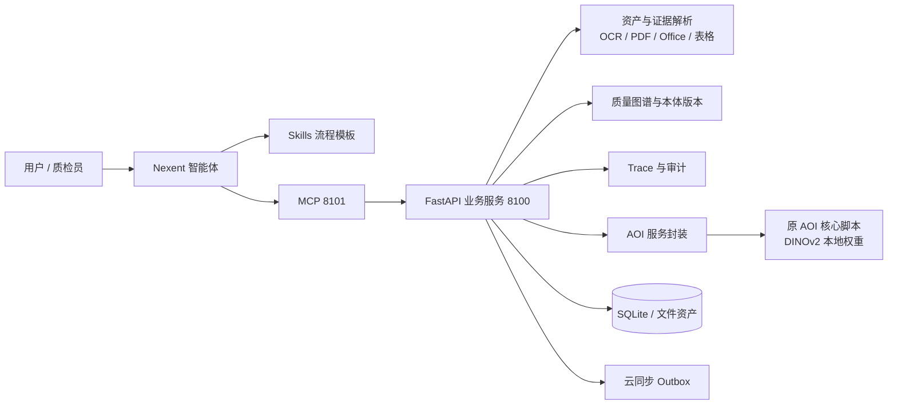
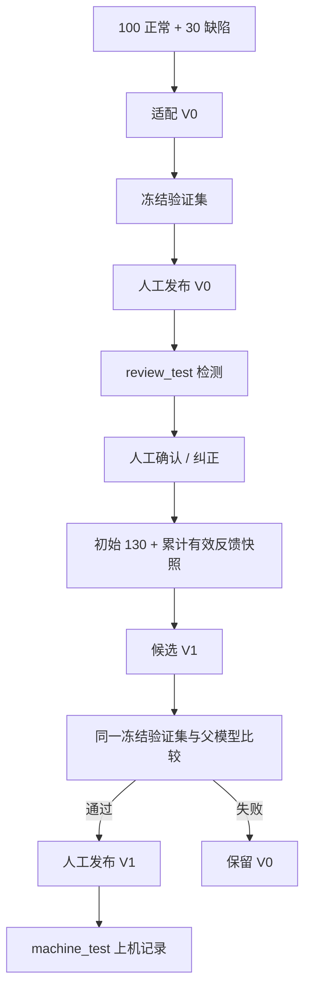

# 系统架构与版本边界

Nexent 负责对话推理、工具选择和 Skill 编排。MCP 是智能体与业务服务之间的工具协议。业务服务负责硬约束、数据版本、人工审核、回归门禁与证据记录。AOI 核心继续使用外部目录中的算法脚本和权重，业务工程不改变异常分数的含义。

## 三类版本

| 版本类型 | 示例 | 含义 |
|---|---|---|
| 智能体发布版本 | Nexent 页面 V1/V2 | Agent 配置、提示词、工具和 Skills 的发布历史 |
| AOI 实验版本 | V0/V1 | 面向演示的模型代号；对应真实 `model_...` ID |
| 本体版本 | `ontology_v3`/`ontology_v4` | 标准映射和知识结构的审核发布历史 |

三类版本独立演进。Nexent 页面显示 V2 不代表 AOI 已训练两轮，也不代表本体版本为 v2。

## 受控进化流程

验证集不参与适配。`machine_test` 的机器结果不会成为学习标签。发布使用 `expected_current` 防止过期父版本切换。
